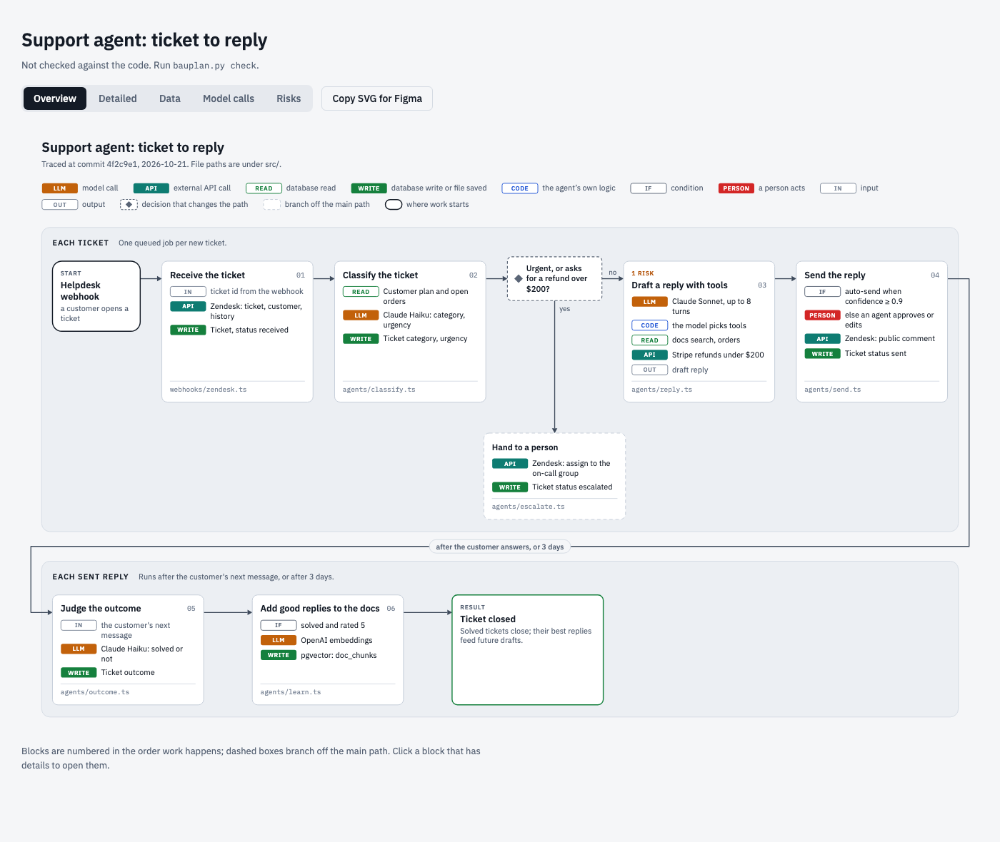
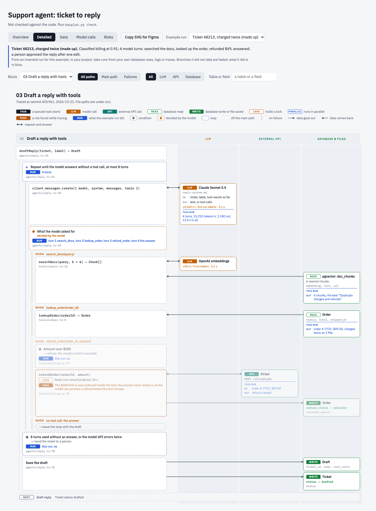
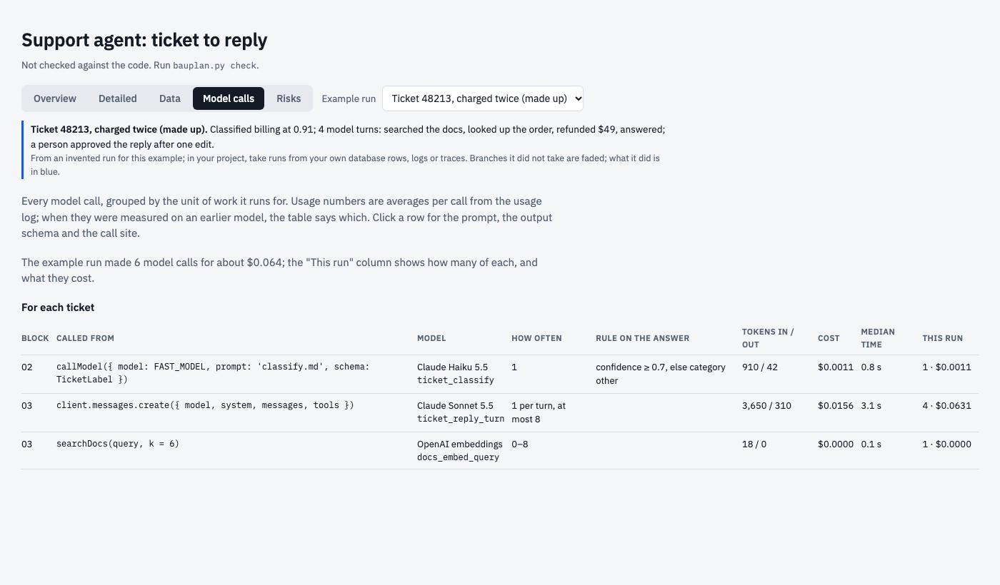

<p align="center"></p>

# Bauplan

**See how your AI agent actually works.**

Bauplan is a skill for Claude Code. Point it at the code of an AI agent and it draws a *bauplan*, German for "building plan": a block-diagram overview of the whole workflow, and behind every block the functions in the order they run, with every LLM call, tool call, API call, database read and write, condition, loop and failure path. It checks every row it draws against your code, so the diagram tells you when it has gone out of date.

[Live demo](https://sailaukan.github.io/bauplan/) · [Install](#install) · [Use](#use) · [Format](references/spec.md)



## Why

Agent code is hard to hold in your head. One request crosses queues, model calls, tools and retries, and the model itself decides part of the path. A diagram drawn by hand, or with a one-off prompt, looks right on the day and is wrong a week later. Bauplan is written by tracing the code, and it checks itself against the code every time it renders.

## What you get

One page, `docs/agent-workflow/index.html`, with five views:

| View | Shows |
| --- | --- |
| **Overview** | 6 to 14 numbered blocks in bands, one band per unit of work (each request, each document), and the decisions that split the path. |
| **Detailed** | Each block's functions in the order they run, nested by call, condition and loop. Every model, API and database call is an arrow into its own column. Choices the model makes are marked, side and failure paths are faded, and you can show only the main path or only the failures. |
| **Data** | Every table and store, the status values it moves through and the step that sets each one, and every step that reads or writes it. |
| **Model calls** | Every model call, how often it runs per unit of work, its prompt and output schema, and tokens, cost and time per call when your usage logs have them. |
| **Risks** | Problems found while tracing, such as races, paths that never run or settings nothing sets, each linked to its line of code. |



- **Example runs.** Lay a real run over the diagram: the branches it took, what each model was sent and returned, what it wrote, what it cost.
- **Click through.** Every function opens its line on GitHub, GitLab or in your editor; every call opens a card with its prompt, output schema and usage.
- **Checked against the code.** The page says how many rows were found, which moved, and which blocks changed since the diagram was drawn. In CI, `check` fails when something it names is gone.
- **Copy to Figma.** One button copies the overview or the detailed view as an SVG that pastes into Figma as editable shapes.



## Install

**As a Claude Code plugin.** In Claude Code:

```
/plugin marketplace add Sailaukan/bauplan
/plugin install bauplan@bauplan
```

**As a skill for every project on your machine:**

```bash
git clone https://github.com/Sailaukan/bauplan ~/.claude/skills/bauplan
```

**For one repository**, so everyone working on it has it: clone it into that repository's `.claude/skills/bauplan` and commit it.

You need Python 3; the scripts use only the standard library. Git is optional: without it the check still verifies every row, but cannot say what changed since the diagram was drawn.

## Use

In Claude Code, in your agent's repository, ask:

> Draw the bauplan of this agent.

or run `/bauplan`. Claude finds where work starts, follows it through the code, writes `docs/agent-workflow/workflow.json`, checks it, and renders `docs/agent-workflow/index.html`. Open that file in a browser.

The first run reads the code properly, so it takes a while; on a large agent Claude can split the tracing across parallel subagents. It also tells you what looked wrong along the way.

After you change the agent:

> Update the bauplan.

It runs the check, retraces only the blocks whose code changed, and renders again.

## What it writes

Everything goes in `docs/agent-workflow/`:

| File | What it is |
| --- | --- |
| `workflow.json` | The source: the overview and every traced row. Commit it. |
| `index.html` | The page, rendered from the files beside it. One self-contained file. |
| `stats.json` | Optional. Usage numbers per model call, from your usage logs. |
| `examples.json` | Optional. One or two real runs to lay over the diagram. |

The page embeds your prompt files and code paths. Treat it like your code before you share it outside your team.

## Keep it true in CI

```yaml
# .github/workflows/bauplan.yml
name: bauplan
on: [pull_request]
jobs:
  check:
    runs-on: ubuntu-latest
    steps:
      - uses: actions/checkout@v4
        with:
          fetch-depth: 0
      - run: curl -sSLo bauplan.py https://raw.githubusercontent.com/Sailaukan/bauplan/main/scripts/bauplan.py
      - run: python3 bauplan.py check docs/agent-workflow/workflow.json
```

`check` fails when a function the diagram names is gone or a prompt file is missing, and lists the blocks whose code changed since the diagram was drawn.

## Works with

- **Any language.** The check finds function definitions in Python, JavaScript, TypeScript, Go, Ruby, Rust, PHP, Java, Kotlin, C#, Swift and similar, and matches plain text for everything else.
- **Any framework and model provider.** Bauplan reads your code, not a framework's metadata.
- **Any usage log** that records model calls by name: a table in your database, Langfuse, LangSmith, Helicone, OpenTelemetry traces or provider exports.

## How it works

| File | Role |
| --- | --- |
| `SKILL.md` | Tells Claude how to trace an agent and what makes the diagram readable. |
| `references/spec.md` | The format of `workflow.json`, `stats.json` and `examples.json`. |
| `scripts/bauplan.py` | Checks the workflow against the code and renders the page. |
| `assets/viewer.html` | The page itself. |
| `assets/example-workflow.json` | The support agent from the demo, a complete example of the format. |

You can also run the script yourself:

```bash
python3 scripts/bauplan.py check  docs/agent-workflow/workflow.json [--fix]
python3 scripts/bauplan.py render docs/agent-workflow/workflow.json [--out PATH]
```

## License

MIT
